<table>
<tr>
<td width="50%" align="center" valign="middle">

</td>
<td width="50%" align="center" valign="middle">

</td>
</tr>
</table>

---

## 🌐 Connect With Me

  
  
  
  
  
  

---

## 🧑‍💻 About Me

> 👇 Click each section to expand

<b>👋 Who am I?</b>

 

I'm **Sachin Kumar**, a **Software Engineer** and **Full Stack Developer** from **Bihar, India**. I enjoy turning ideas into working products, from responsive websites to deep learning models, and I'm always looking for the next thing to learn.

<b>🌱 What I'm learning right now</b>

 

| Focus Area | Progress |
|------------|----------|
| 📚 Full-Stack Development |  |
| 🧠 Data Structures & Algorithms |  |
| 🤖 AI & Machine Learning |  |

<b>🔭 What I'm working on</b>

 

- 🌐 Growing my [portfolio website](https://sachin2501.github.io/portfolio_website.io/)
- 🍔 Full-stack apps with React, Node.js and MongoDB
- 🤟 Deep learning projects like sign language detection
- 🏆 Hackathon projects and AI-driven mapping

<b>💬 Ask me about</b>

 

`HTML` · `CSS` · `JavaScript` · `React` · `Python` · `C / C++` · `Java` · `PHP & MySQL` · `Machine Learning basics`

<b>⚡ Fun facts</b>

 

- 😄 I'm funny (my friends may disagree)
- 🏆 I earned the **Quickdraw** achievement on GitHub
- 🚀 I love hackathons because deadlines make me productive

<b>🤝 Let's collaborate</b>

 

I'm open to **open source contributions**, **hackathon teams** and **internship opportunities**. Message me on [LinkedIn](https://www.linkedin.com/in/sachin-kumar-sharma2501) or email **sachinkumar.gheura@gmail.com**.

---

## 🛠️ Languages & Tools

  
  
  
  
  
  

  
  
  
  
  
  
  
  

---

## 📊 GitHub Stats & Top Languages

  
  
  

  <b>Top languages in my projects</b>  
  
  
  
  
   Based on my 6 featured projects

  <b>🏆 Achievements</b>  
  

---

## 🚀 Featured Projects

<table>
<tr>
<td width="33%" valign="top">
<h4><a href="https://github.com/Sachin2501/portfolio_website.io">🌐 Portfolio Website</a></h4>

Responsive portfolio with animations, typing effects and a project showcase.

</td>
<td width="33%" valign="top">
<h4><a href="https://github.com/Sachin2501/Food_app_Client_frontend">🍔 Food Delivery App</a></h4>

Browse restaurants, order food online and track delivery. React, Node.js, MongoDB.

</td>
<td width="33%" valign="top">
<h4><a href="https://github.com/Sachin2501/PG-Life-Project">🏠 PG Life</a></h4>

Find PG accommodations across cities. PHP and MySQL.

</td>
</tr>
<tr>
<td width="33%" valign="top">
<h4><a href="https://github.com/Sachin2501/Sign_Language_Detection_DeepLearning_Project">🤟 Sign Language Detection</a></h4>

Deep learning model that detects and classifies sign language gestures.

</td>
<td width="33%" valign="top">
<h4><a href="https://github.com/Sachin2501/Hacksphare-2K25-Hackathon-project">🚨 Hacksphere 2K25</a></h4>

Live location tracking and emergency alert system with Google Maps.

</td>
<td width="33%" valign="top">
<h4><a href="https://github.com/Sachin2501/AIDriven-Archaeological-Site-Mapping">🏺 Archaeological Site Mapping</a></h4>

Models that classify vegetation land and soil type.

</td>
</tr>
</table>

<a href="https://github.com/Sachin2501?tab=repositories">View all repositories →</a>

---

## 💡 Dev Quote

  

---

## 💼 Hire Me / Contact

<table>
<tr>
<td align="center" width="560">

### Let's build something together 🚀

Software Engineer and Full Stack Developer open to **internships**, **freelance projects** and **hackathon teams**. 
Have an idea or an opportunity? Drop me a message!

 

  

📧 **sachinkumar.gheura@gmail.com**

</td>
</tr>
</table>

---

### ⭐ Thanks for stopping by! If you like my work, give my repos a star.

